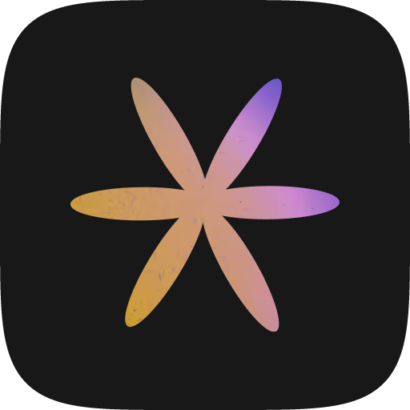

<p align="center">
  <a href="https://nativebloom.dev">
    
  </a>
</p>

<h1 align="center">Native Bloom</h1>

<p align="center">
  <strong>React Native UI for agents and humans.</strong>
</p>

<p align="center">
  A handpicked, living catalog of React Native UI from real builders.<br />
  Preview every block on video, find it in seconds, and ship it with your agent.
</p>

<p align="center">
  <a href="https://nativebloom.dev/blocks"><strong>Explore blocks →</strong></a>
  &nbsp;·&nbsp;
  <a href="https://nativebloom.dev/mcp">MCP</a>
  &nbsp;·&nbsp;
  <a href="https://nativebloom.dev/#pricing">Pricing</a>
  &nbsp;·&nbsp;
  <a href="https://x.com/nativebloomdev">X</a>
</p>

---

## Great UI is easy to see and hard to find again

You saw the perfect animation on X. You bookmarked it. Three months later it's gone.

You found a promising library, but to see what it looks like you have to clone the repo,
install everything, and run the example app. Many libraries have no preview at all.

And if you step away from the community for a few months, you fall behind.

**Native Bloom fixes that.** One catalog where every block is on video, searchable by
what it is, with the context your agent needs to put it in your app.

## What's inside

Blocks are components, animations, and patterns from npm libraries, open source
collections, paid kits, articles, videos, and social posts. Each one is reviewed by
hand before it goes live, and new ones are added almost every day.

| | |
| --- | --- |
| **See it on video** | Every block has a short video preview. Judge the motion and layout in seconds, without a clone-and-run. |
| **Browse by vibe** | Filter by component, animation, collection, package, or author. You can explore before you know what the thing is called. |
| **Ask the catalog** | Describe the UI you need. The Pro assistant searches the catalog and filters the feed for you. |
| **Learn how it works** | Ask how a block works. The assistant reads the real source, docs, and GitHub before it explains. |
| **Ask from your editor** | Connect Cursor, Claude Code, Codex, or any MCP client. Your agent finds a block and pulls the source. |
| **Ship with your agent** | Copy a prompt written for your coding agent, or open it straight in Codex, Claude Code, or Cursor. |

## Use it from your editor

Point your MCP client at the catalog:

```json
{
  "mcpServers": {
    "native-bloom": {
      "url": "https://mcp.nativebloom.dev/mcp"
    }
  }
}
```

Then ask your agent for "a bottom sheet with a blurred backdrop" and let it find the block.
Setup for each client is on [nativebloom.dev/mcp](https://nativebloom.dev/mcp).

## Who it's for

- **React Native developers** who want to find production UI fast and stop hunting through GitHub.
- **Developers new to React Native** who want to see what exists before they know the jargon.
- **Designers and vibecoders** who think visually and don't want to clone a repo to see a component.
- **Teams** who want one shared library of references and the same context for every agent.
- **Recruiters** who want to find the people building in React Native through what they ship.

---

<p align="center">
  <a href="https://nativebloom.dev"><strong>nativebloom.dev</strong></a><br />
  <sub>React Native UI blocks. Find it fast, ship it faster.</sub><br />
  <sub>Made by <a href="https://x.com/v_serbulenko">Volodymyr Serbulenko</a></sub>
</p>
